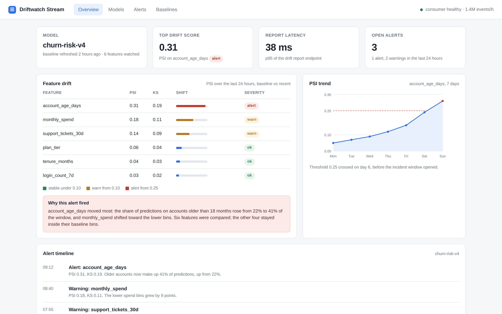
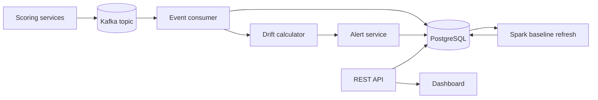

# Driftwatch Stream

A streaming service that watches model predictions for drift and explains each alert in plain words.



## Why

A model that was accurate at launch keeps answering questions about a world that has moved on, and the first sign is often a support ticket rather than a metric. Comparing last week's feature distributions with this week's usually happens in a throwaway notebook, and the result never reaches the people who can act on it. Driftwatch Stream keeps that comparison running as a service: it consumes prediction events, holds rolling baselines, and raises an alert that names the inputs that shifted.

## How it works

Prediction events arrive on a Kafka topic, one event per feature value used for a prediction. The consumer parses each event, appends it to the observations table, and every few hundred events for a feature recomputes drift against the stored baseline. A Spark job rebuilds the baselines from the observation table on a schedule, and the REST API serves the current report and the alert history to the dashboard.



## Key decisions

- Drift is scored at ingest time rather than only in the batch job, so a shift shows up within minutes; the cost is that the consumer does a count and a window read per check interval.
- Bin edges come from the baseline refresh and are reused for the observed proportions, which keeps PSI and KS counted over the same buckets; the cost is that a shift outside the original range lands in the outer bins.
- Alerts are deduplicated per model, feature, severity and hour with a unique index, so a sustained shift does not flood the timeline; the cost is that a second, larger shift in the same hour is folded into the first.
- The service keeps its own tables and reads nothing from the scoring systems, so it can be added beside an existing pipeline; the cost is that producers must emit one event per feature value.

## Tech stack

- Java 17 and Spring Boot 3.2.5 (web, JDBC, Kafka)
- PostgreSQL for observations, baselines and alerts
- Apache Spark (PySpark) for the baseline refresh job
- Python and pytest for the reference implementation and its tests
- Docker image and a Kubernetes Deployment with health probes

## Quick start

Prerequisites: JDK 17, Maven, PostgreSQL 14 or newer, a Kafka broker, and Python 3.10 with PySpark for the refresh job.

```bash
mvn spring-boot:run
mvn test
kubectl apply -f deploy/k8s.yaml
python spark/refresh_baselines.py --jdbc-url jdbc:postgresql://localhost:5432/driftwatch --bins 10
pytest tests/test_drift_calculator.py
```

| Variable | What it sets | Default |
| --- | --- | --- |
| `DRIFTWATCH_DB_URL` | JDBC URL of the PostgreSQL database | `jdbc:postgresql://localhost:5432/driftwatch` |
| `DRIFTWATCH_DB_USER` | Database user | `driftwatch` |
| `DRIFTWATCH_DB_PASSWORD` | Database password | `driftwatch` |
| `DRIFTWATCH_KAFKA` | Kafka bootstrap servers | `localhost:9092` |
| `DRIFTWATCH_TOPIC` | Topic the consumer reads | `model.predictions` |
| `DRIFTWATCH_GROUP` | Consumer group id | `driftwatch-stream` |

## Usage

```bash
curl -s localhost:8080/api/models/churn-v3/drift
```

```json
{
  "modelId": "churn-v3",
  "driftScore": 0.31,
  "topFeature": "days_since_login",
  "features": [
    {"feature": "days_since_login", "psi": 0.31, "ks": 0.22, "severity": "alert", "sampleSize": 500},
    {"feature": "plan_tier", "psi": 0.12, "ks": 0.09, "severity": "warning", "sampleSize": 500}
  ],
  "generatedAt": "2025-03-11T09:14:02Z"
}
```

## Project structure

```text
src/main/java/io/driftwatch/   service code: ingest, store, drift, alert, api
src/main/resources/            application.yml and schema.sql
spark/                         baseline refresh job
tests/                         Python tests for the PSI and KS reference
deploy/                        Kubernetes Deployment and Service
ui/                            single-page dashboard
```

## Limitations

- The baseline refresh runs as a separate Spark job; the service does not trigger it on its own.
- Only numeric features are scored; categorical features need to be encoded before they reach the topic.
- Alert explanations name the feature and the size of the shift, not the upstream cause.
- The dashboard reads the API on load and does not refresh itself.

## License

MIT. The project builds on Spring Boot and Apache Spark, both under the Apache License 2.0.
